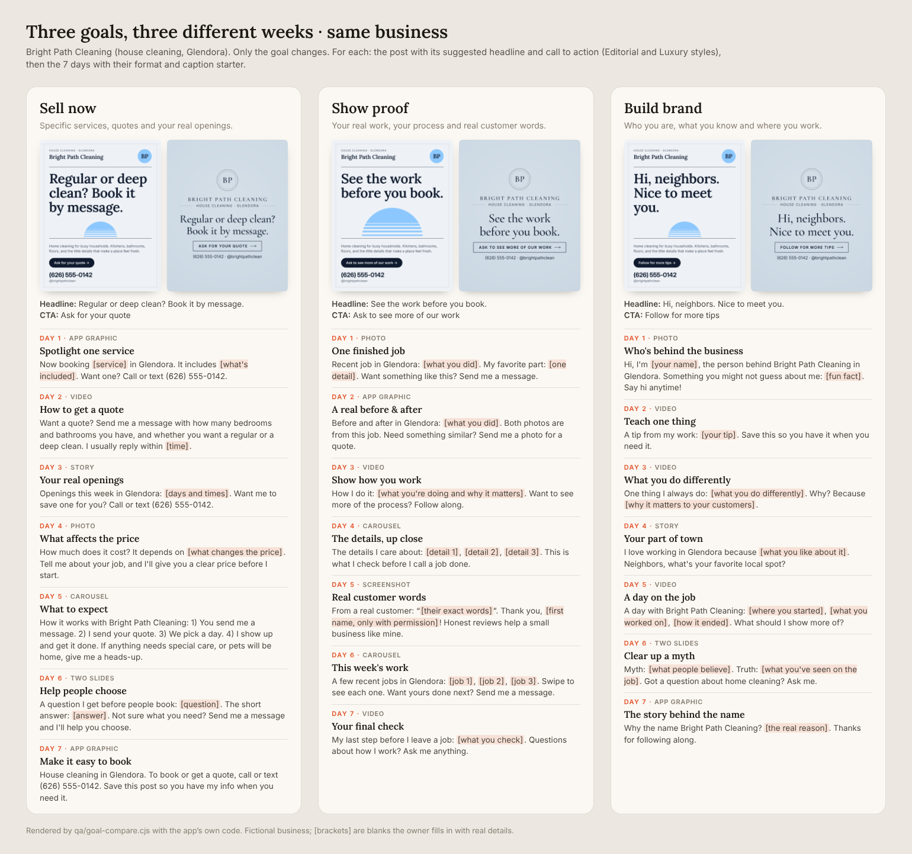
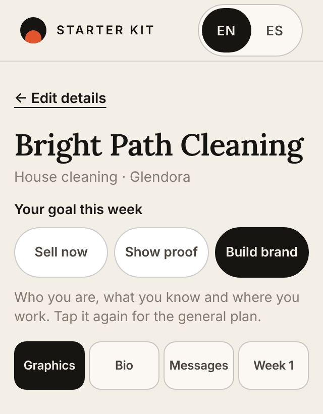
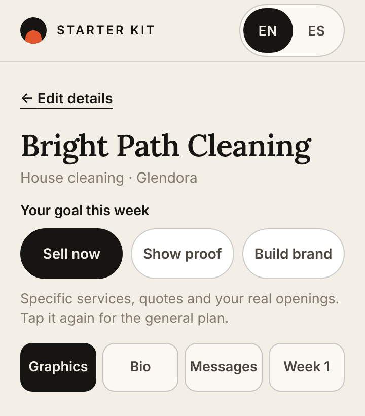
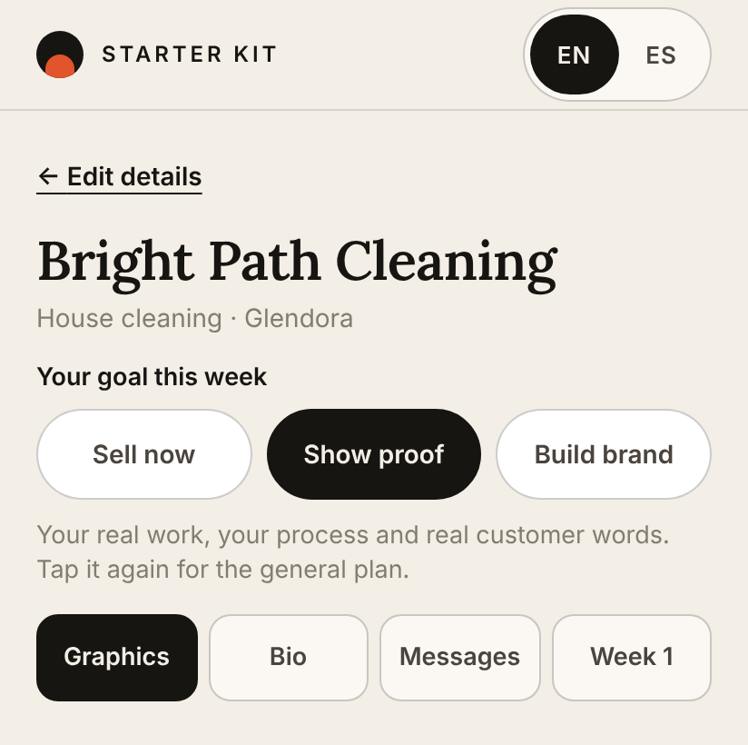
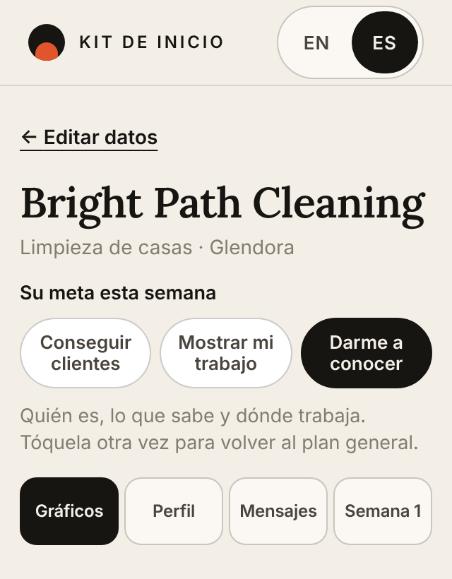
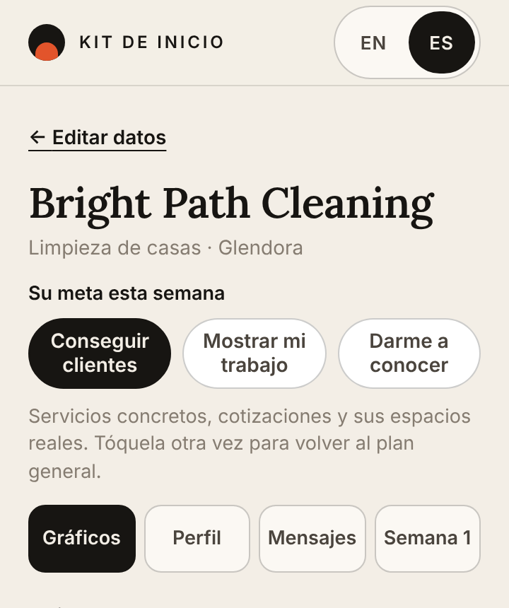
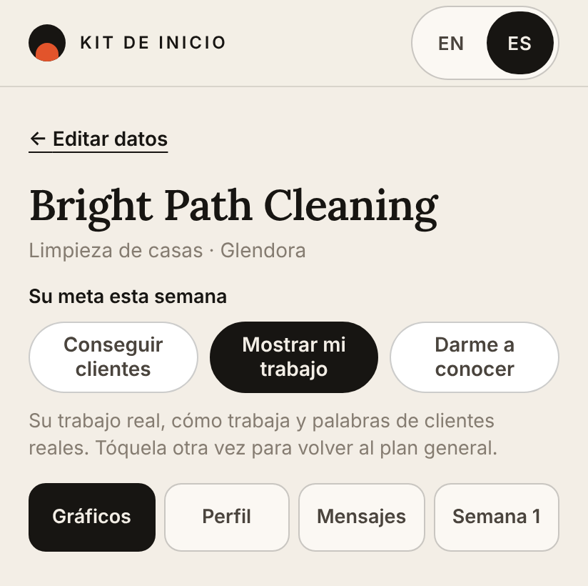
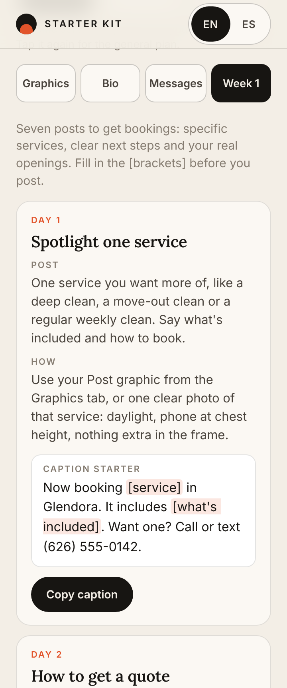
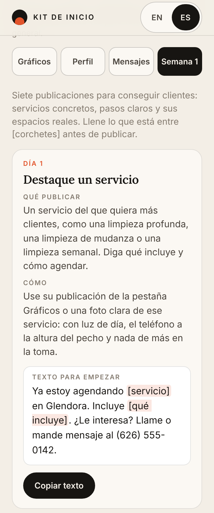

# Marketing goals · three Week 1 plans for the same business

One fictional business, **Bright Path Cleaning** (house cleaning, Glendora, (626) 555-0142), with nothing else changed but the goal.
Generated by `node qa/goal-compare.cjs` from `index.html` with the app's own copy code, so this is word for word what an owner sees.
Anything in [brackets] is a blank the owner fills in with real details before posting.

## The week at a glance

| Day | General plan (no goal, unchanged) | Sell now | Show proof | Build brand |
|---|---|---|---|---|
| 1 | Introduce yourself · *photo* | Spotlight one service · *app graphic* | One finished job · *photo* | Who's behind the business · *photo* |
| 2 | Before & after · *photo* | How to get a quote · *video* | A real before & after · *app graphic* | Teach one thing · *video* |
| 3 | One quick tip · *video* | Your real openings · *Story* | Show how you work · *video* | What you do differently · *video* |
| 4 | Behind the scenes · *video* | What affects the price · *photo* | The details, up close · *carousel* | Your part of town · *Story* |
| 5 | Answer a common question · *video* | What to expect · *carousel* | Real customer words · *screenshot* | A day on the job · *video* |
| 6 | Where you work · *photo* | Help people choose · *two slides* | This week's work · *carousel* | Clear up a myth · *two slides* |
| 7 | Say thank you · *photo* | Make it easy to book · *app graphic* | Your final check · *video* | The story behind the name · *app graphic* |

| Día | Plan general (sin meta) | Conseguir clientes | Mostrar mi trabajo | Darme a conocer |
|---|---|---|---|---|
| 1 | Preséntese | Destaque un servicio | Un trabajo terminado | Quién está detrás del negocio |
| 2 | Antes y después | Cómo pedir una cotización | Un antes y después real | Enseñe algo útil |
| 3 | Un consejo rápido | Sus espacios disponibles | Muestre cómo trabaja | Lo que usted hace distinto |
| 4 | Detrás de cámaras | De qué depende el precio | Los detalles, de cerca | Su zona |
| 5 | Responda una pregunta común | Qué esperar | Palabras de un cliente real | Un día de trabajo |
| 6 | Dónde trabaja | Ayude a escoger | Trabajos de la semana | Aclare un mito |
| 7 | Dé las gracias | Que sea fácil contratarlo | Su revisión final | La historia del nombre |

## Graphics suggestions

The first idea is what the Graphics tab shows when the goal is picked; **Another idea** cycles through the rest. A headline or call to action the owner typed is never replaced.

| Goal | Headline ideas | Call-to-action ideas |
|---|---|---|
| General plan (no goal) | Come home to clean. A cleaner home. Your weekends back. Detail-minded cleaning for busy homes. | Message us for a quote Call or text to book Book your first visit Ask about availability |
| Plan general (sin meta) | Llegue a una casa limpia. Su casa limpia. Su fin de semana libre. Limpieza con atención a cada detalle. | Escríbanos para cotizar Llame o mande mensaje Agende su primera visita Pregunte por disponibilidad |
| Sell now | Regular or deep clean? Book it by message. Your quote is one message away. Now taking new clients. | Ask for your quote Book an appointment Ask about open dates Call or text to book |
| Conseguir clientes | ¿Limpieza regular o profunda? Agende por mensaje. Su cotización, a un mensaje de distancia. Aceptamos clientes nuevos. | Pida su cotización Agende su cita Pregunte por fechas disponibles Llame o mande mensaje |
| Show proof | See the work before you book. Our work, up close. Done with care, start to finish. | Ask to see more of our work Want this done? Message us Ask about a job like this Message us for a quote |
| Mostrar mi trabajo | Vea el trabajo antes de agendar. Nuestro trabajo, de cerca. Con cuidado, de principio a fin. | Pida ver más de nuestro trabajo ¿Quiere algo así? Escríbanos Pregunte por un trabajo así Escríbanos para cotizar |
| Build brand | Hi, neighbors. Nice to meet you. Get to know who does the work. Home cleaning: ask us anything. | Follow for more tips Questions? Just ask Say hi anytime Get to know us |
| Darme a conocer | Hola, vecinos. Mucho gusto. Conozca a quien hace el trabajo. Limpieza de casas: pregúntenos lo que quiera. | Síganos para más consejos ¿Preguntas? Escríbanos Salúdenos cuando guste Conózcanos |

The bio, the About text and the five customer messages are the same for every goal (the bio keeps the general call to action).

## Sell now · Conseguir clientes

*Seven posts to get bookings: specific services, clear next steps and your real openings. Fill in the [brackets] before you post.*

**Day 1 · Spotlight one service** (app graphic)

- **Post:** One service you want more of, like a deep clean, a move-out clean or a regular weekly clean. Say what's included and how to book.
- **How:** Use your Post graphic from the Graphics tab, or one clear photo of that service: daylight, phone at chest height, nothing extra in the frame.
- **Caption starter:** Now booking [service] in Glendora. It includes [what's included]. Want one? Call or text (626) 555-0142.

**Day 2 · How to get a quote** (video)

- **Post:** Tell people exactly what to send you for a quote: how many bedrooms and bathrooms you have, and whether you want a regular or a deep clean.
- **How:** Phone upright, near a window, talking to the camera for about 15 seconds. Say what to send and how soon you usually reply. Add captions for people watching with the sound off.
- **Caption starter:** Want a quote? Send me a message with how many bedrooms and bathrooms you have, and whether you want a regular or a deep clean. I usually reply within [time].

**Day 3 · Your real openings** (Story)

- **Post:** A Story with the days or times you really have open this week. Only post openings you actually have.
- **How:** Use your Story graphic and type the days on top with Instagram's text tool, or photograph your planner with the open days circled. Cover other clients' names.
- **Caption starter:** Openings this week in Glendora: [days and times]. Want me to save one for you? Call or text (626) 555-0142.

**Day 4 · What affects the price** (photo)

- **Post:** Explain what changes the price of a job, like size, condition or extras, so people know what to expect. Share a set price only if you really have one.
- **How:** Write the three things that change the price in big text, one per line, over a clean photo of your work. Check that it reads easily on a small screen.
- **Caption starter:** How much does it cost? It depends on [what changes the price]. Tell me about your job, and I'll give you a clear price before I start.

**Day 5 · What to expect** (carousel)

- **Post:** Walk people through hiring you, from first message to finished job, in four short steps.
- **How:** A carousel of four vertical photos, one per step: your phone with a message (no client details), arriving, working, the finished job. Shoot them all in daylight so the set matches.
- **Caption starter:** How it works with Bright Path Cleaning: 1) You send me a message. 2) I send your quote. 3) We pick a day. 4) I show up and get it done. If anything needs special care, or pets will be home, give me a heads-up.

**Day 6 · Help people choose** (two slides)

- **Post:** Answer a question people ask before they book, like the difference between a regular clean and a deep clean.
- **How:** Two slides: the question in big text on the first, your answer on the second. Or answer it to the camera in under 20 seconds.
- **Caption starter:** A question I get before people book: [question]. The short answer: [answer]. Not sure what you need? Send me a message and I'll help you choose.

**Day 7 · Make it easy to book** (app graphic)

- **Post:** A simple post with your service, your area and how to reach you, pinned to the top of your profile.
- **How:** Use your Post graphic (it shows the contact details you entered) and pin it. Answer new messages the same day if you can, and two days after a quote, send the “Estimate follow-up” from the Messages tab.
- **Caption starter:** House cleaning in Glendora. To book or get a quote, call or text (626) 555-0142. Save this post so you have my info when you need it.

En español

*Siete publicaciones para conseguir clientes: servicios concretos, pasos claros y sus espacios reales. Llene lo que está entre [corchetes] antes de publicar.*

**Día 1 · Destaque un servicio**

- **Qué publicar:** Un servicio del que quiera más clientes, como una limpieza profunda, una limpieza de mudanza o una limpieza semanal. Diga qué incluye y cómo agendar.
- **Cómo:** Use su publicación de la pestaña Gráficos o una foto clara de ese servicio: con luz de día, el teléfono a la altura del pecho y nada de más en la toma.
- **Texto para empezar:** Ya estoy agendando [servicio] en Glendora. Incluye [qué incluye]. ¿Le interesa? Llame o mande mensaje al (626) 555-0142.

**Día 2 · Cómo pedir una cotización**

- **Qué publicar:** Diga exactamente qué le deben mandar para cotizar: cuántas recámaras y baños tiene, y si busca una limpieza regular o profunda.
- **Cómo:** Teléfono en vertical, cerca de una ventana, hablando a la cámara unos 15 segundos. Diga qué le deben mandar y en cuánto tiempo suele responder. Agregue subtítulos para quien lo vea sin sonido.
- **Texto para empezar:** ¿Quiere una cotización? Mándeme un mensaje con cuántas recámaras y baños tiene, y si busca una limpieza regular o profunda. Normalmente respondo en [tiempo].

**Día 3 · Sus espacios disponibles**

- **Qué publicar:** Una historia con los días u horarios que de verdad tiene libres esta semana. Publique solo los espacios que sí tiene.
- **Cómo:** Use su historia de la pestaña Gráficos y escriba los días encima con la herramienta de texto de Instagram, o tómele foto a su agenda con los días libres marcados. Tape los nombres de otros clientes.
- **Texto para empezar:** Tengo espacio esta semana en Glendora: [días y horarios]. ¿Le aparto uno? Llame o mande mensaje al (626) 555-0142.

**Día 4 · De qué depende el precio**

- **Qué publicar:** Explique qué cambia el precio de un trabajo, como el tamaño, la condición o los extras, para que sepan qué esperar. Dé un precio fijo solo si de verdad lo tiene.
- **Cómo:** Escriba en letras grandes las tres cosas que cambian el precio, una por línea, sobre una foto limpia de su trabajo. Revise que se lea fácil en una pantalla chica.
- **Texto para empezar:** ¿Cuánto cuesta? Depende de [lo que cambia el precio]. Cuénteme qué necesita y le doy un precio claro antes de empezar.

**Día 5 · Qué esperar**

- **Qué publicar:** Explique en cuatro pasos cortos cómo es contratarlo, desde el primer mensaje hasta el trabajo terminado.
- **Cómo:** Un carrusel de cuatro fotos verticales, una por paso: su teléfono con un mensaje (sin datos del cliente), cuando llega, trabajando y el trabajo terminado. Tómelas todas con luz de día para que combinen.
- **Texto para empezar:** Así funciona con Bright Path Cleaning: 1) Usted me manda un mensaje. 2) Le mando su cotización. 3) Escogemos el día. 4) Llego y hago el trabajo. Si hay algo que necesite cuidado especial, o si va a haber mascotas en casa, dígamelo con tiempo.

**Día 6 · Ayude a escoger**

- **Qué publicar:** Responda una pregunta que le hacen antes de contratar, como la diferencia entre una limpieza regular y una limpieza profunda.
- **Cómo:** Dos imágenes: la pregunta en letras grandes en la primera y su respuesta en la segunda. O respóndala a la cámara en menos de 20 segundos.
- **Texto para empezar:** Una pregunta que me hacen antes de agendar: [pregunta]. La respuesta corta: [respuesta]. ¿Tiene dudas sobre qué necesita? Mándeme un mensaje y le ayudo a escoger.

**Día 7 · Que sea fácil contratarlo**

- **Qué publicar:** Una publicación sencilla con su servicio, su zona y cómo contactarlo, fijada arriba en su perfil.
- **Cómo:** Use su publicación de la pestaña Gráficos (muestra los datos de contacto que escribió) y fíjela en su perfil. Si puede, conteste los mensajes nuevos el mismo día, y dos días después de cotizar mande el “Seguimiento de cotización” de la pestaña Mensajes.
- **Texto para empezar:** Limpieza de casas en Glendora. Para agendar o pedir una cotización, llame o mande mensaje al (626) 555-0142. Guarde esta publicación para tener mis datos a la mano.

## Show proof · Mostrar mi trabajo

*Seven posts that show your real work. Use only your own photos and real customer words. Fill in the [brackets] before you post.*

**Day 1 · One finished job** (photo)

- **Post:** A clear photo of a kitchen or bathroom you cleaned. Only your own work.
- **How:** Open the curtains or turn on every light, wipe your lens, take one wide shot, then one close-up. Ask the client first, and leave out faces, house numbers and license plates. No client photos yet? Do a job at your own place or for someone you know, and say so.
- **Caption starter:** Recent job in Glendora: [what you did]. My favorite part: [one detail]. Want something like this? Send me a message.

**Day 2 · A real before & after** (app graphic)

- **Post:** Two photos of the same job, before and after, in the Before & after post on the Graphics tab.
- **How:** Take the before photo before you touch anything, then the after from the same spot and height, in the same light. No filters or edits that make the work look better than it is. No before photo this time? Skip this one and take it at your next job.
- **Caption starter:** Before and after in Glendora: [what you did]. Both photos are from this job. Need something similar? Send me a photo for a quote.

**Day 3 · Show how you work** (video)

- **Post:** Film yourself wiping down a stovetop or a glass shower door, 15 to 30 seconds.
- **How:** Prop the phone up vertically at the height of the work. Record a few 3 to 5 second clips and keep the real sound. Show your hands and the work, not the client's home or belongings.
- **Caption starter:** How I do it: [what you're doing and why it matters]. Want to see more of the process? Follow along.

**Day 4 · The details, up close** (carousel)

- **Post:** Three close-up photos of small details that show careful work.
- **How:** Move the phone closer instead of zooming, tap the screen to focus, and use side light from a window so texture shows. Post them together as a carousel.
- **Caption starter:** The details I care about: [detail 1], [detail 2], [detail 3]. This is what I check before I call a job done.

**Day 5 · Real customer words** (screenshot)

- **Post:** A real review or message a customer sent you, shared with their permission.
- **How:** Screenshot it, cover their last name and photo, and don't change a word. No reviews yet? Never write one yourself: send the “Review request” from the Messages tab, and post a thank-you photo instead.
- **Caption starter:** From a real customer: “[their exact words]”. Thank you, [first name, only with permission]! Honest reviews help a small business like mine.

**Day 6 · This week's work** (carousel)

- **Post:** A carousel of 3 to 5 photos from different jobs.
- **How:** Shoot each one the same way: vertical, daylight, same distance. Put the clearest photo first. Ask each client first. Slow week? Use earlier jobs and say when they're from.
- **Caption starter:** A few recent jobs in Glendora: [job 1], [job 2], [job 3]. Swipe to see each one. Want yours done next? Send me a message.

**Day 7 · Your final check** (video)

- **Post:** The last thing you do before you leave a job: your walk-through or checklist.
- **How:** Film a slow walk through a finished job, about 20 seconds, phone steady at chest height, and say what you check. Pick a quiet moment with no music so your voice is clear.
- **Caption starter:** My last step before I leave a job: [what you check]. Questions about how I work? Ask me anything.

En español

*Siete publicaciones para mostrar su trabajo real. Use solo sus propias fotos y palabras reales de sus clientes. Llene lo que está entre [corchetes] antes de publicar.*

**Día 1 · Un trabajo terminado**

- **Qué publicar:** Una foto clara de una cocina o un baño que limpió. Solo trabajo suyo.
- **Cómo:** Abra las cortinas o prenda todas las luces, limpie el lente, tome una foto de lejos y luego una de cerca. Pida permiso al cliente y no muestre caras, números de casa ni placas. ¿Todavía no tiene fotos de clientes? Haga un trabajo en su casa o para alguien conocido, y dígalo.
- **Texto para empezar:** Trabajo reciente en Glendora: [lo que hizo]. Lo que más me gustó: [un detalle]. ¿Quiere algo así? Mándeme un mensaje.

**Día 2 · Un antes y después real**

- **Qué publicar:** Dos fotos del mismo trabajo, antes y después, con la publicación de Antes y después de la pestaña Gráficos.
- **Cómo:** Tome la foto de antes sin mover nada, y la de después desde el mismo lugar, a la misma altura y con la misma luz. Sin filtros ni ediciones que hagan ver el trabajo mejor de lo que quedó. ¿No tomó foto de antes? Sáltese esta y tómela en su próximo trabajo.
- **Texto para empezar:** Antes y después en Glendora: [lo que hizo]. Las dos fotos son de este trabajo. ¿Necesita algo parecido? Mándeme una foto y le cotizo.

**Día 3 · Muestre cómo trabaja**

- **Qué publicar:** Grábese limpiando una estufa o la puerta de vidrio de la regadera, de 15 a 30 segundos.
- **Cómo:** Recargue el teléfono en vertical, a la altura del trabajo. Grabe varios clips de 3 a 5 segundos y deje el sonido real. Muestre sus manos y el trabajo, no la casa ni las cosas del cliente.
- **Texto para empezar:** Así lo hago: [qué está haciendo y por qué importa]. ¿Quiere ver más del proceso? Sígame.

**Día 4 · Los detalles, de cerca**

- **Qué publicar:** Tres fotos de cerca de detalles pequeños que muestran un trabajo cuidadoso.
- **Cómo:** Acerque el teléfono en vez de usar el zoom, toque la pantalla para enfocar y use la luz de una ventana de lado para que se note la textura. Publíquelas juntas como carrusel.
- **Texto para empezar:** Los detalles que cuido: [detalle 1], [detalle 2], [detalle 3]. Esto es lo que reviso antes de dar un trabajo por terminado.

**Día 5 · Palabras de un cliente real**

- **Qué publicar:** Una reseña o un mensaje real que le mandó un cliente, compartido con su permiso.
- **Cómo:** Tómele captura, tape su apellido y su foto, y no cambie ni una palabra. ¿Todavía no tiene reseñas? Nunca escriba una usted: mande el mensaje “Pedir una reseña” de la pestaña Mensajes y publique una foto para dar las gracias.
- **Texto para empezar:** De un cliente real: “[sus palabras exactas]”. ¡Gracias, [nombre, solo con su permiso]! Las reseñas honestas ayudan mucho a un negocio pequeño como el mío.

**Día 6 · Trabajos de la semana**

- **Qué publicar:** Un carrusel de 3 a 5 fotos de distintos trabajos.
- **Cómo:** Tómelas todas igual: en vertical, con luz de día y a la misma distancia. Ponga primero la foto más clara. Pida permiso a cada cliente. ¿Semana tranquila? Use trabajos anteriores y diga de cuándo son.
- **Texto para empezar:** Algunos trabajos recientes en Glendora: [trabajo 1], [trabajo 2], [trabajo 3]. Deslice para ver cada uno. ¿Le gustaría agendar el suyo? Mándeme un mensaje.

**Día 7 · Su revisión final**

- **Qué publicar:** Lo último que hace antes de irse de un trabajo: su recorrido o su lista de revisión.
- **Cómo:** Grábese caminando despacio por un trabajo terminado, unos 20 segundos, con el teléfono firme a la altura del pecho, y diga qué revisa. Busque un momento tranquilo, sin música, para que se oiga bien su voz.
- **Texto para empezar:** Mi último paso antes de irme de un trabajo: [lo que revisa]. ¿Tiene preguntas sobre cómo trabajo? Pregúnteme lo que quiera.

## Build brand · Darme a conocer

*Seven posts that help people get to know you: who you are, what you know and where you work. Fill in the [brackets] before you post.*

**Day 1 · Who's behind the business** (photo)

- **Post:** A photo of you (or you and your crew) and three things: your name, what you do and something people wouldn't guess about you.
- **How:** Stand near a window or in open shade, phone at eye level, and smile like you're greeting a client. Ask someone to take it, or prop the phone up and use the timer.
- **Caption starter:** Hi, I'm [your name], the person behind Bright Path Cleaning in Glendora. Something you might not guess about me: [fun fact]. Say hi anytime!

**Day 2 · Teach one thing** (video)

- **Post:** A short video sharing one two-minute habit that keeps a bathroom cleaner between visits.
- **How:** Phone upright at eye level. Say the tip in the first 2 seconds and keep the whole video under 30 seconds. Add captions so it works with the sound off.
- **Caption starter:** A tip from my work: [your tip]. Save this so you have it when you need it.

**Day 3 · What you do differently** (video)

- **Post:** One real thing you do differently, and why it matters to your customers.
- **How:** Show it instead of just saying it: a photo or clip of that habit in action, like the text you send when you're on your way or how you leave the space. Only claim what you really do every time.
- **Caption starter:** One thing I always do: [what you do differently]. Why? Because [why it matters to your customers].

**Day 4 · Your part of town** (Story)

- **Post:** A Story from somewhere around Glendora, with a location sticker, and what you like about working there.
- **How:** A local street, park, mural or favorite coffee spot, in daylight. Leave out people's faces and homes. Use a location sticker for your town or a public landmark, not a client's address.
- **Caption starter:** I love working in Glendora because [what you like about it]. Neighbors, what's your favorite local spot?

**Day 5 · A day on the job** (video)

- **Post:** Four or five 3-second clips from one workday: loading up, on the road, working, done, heading home.
- **How:** Film vertical and hold each shot still for 3 seconds. Put them together in Instagram's Reels editor. No client faces, addresses or license plates.
- **Caption starter:** A day with Bright Path Cleaning: [where you started], [what you worked on], [how it ended]. What should I show more of?

**Day 6 · Clear up a myth** (two slides)

- **Post:** Something people often believe about home cleaning that isn't true.
- **How:** Two slides: the myth in big text on the first, the truth on the second. Or say it to the camera in under 20 seconds.
- **Caption starter:** Myth: [what people believe]. Truth: [what you've seen on the job]. Got a question about home cleaning? Ask me.

**Day 7 · The story behind the name** (app graphic)

- **Post:** Why you named your business Bright Path Cleaning, or why you started it. Just the real reason, in a few lines.
- **How:** Use your Post graphic (it shows your logo or initials), or a photo of your truck, sign or workspace. Nothing dramatic? Keep it short. A simple, true reason beats a made-up one.
- **Caption starter:** Why the name Bright Path Cleaning? [the real reason]. Thanks for following along.

En español

*Siete publicaciones para que la gente lo conozca: quién es, lo que sabe y dónde trabaja. Llene lo que está entre [corchetes] antes de publicar.*

**Día 1 · Quién está detrás del negocio**

- **Qué publicar:** Una foto suya (o con su equipo) y tres cosas: su nombre, a qué se dedica y algo que la gente no se imaginaría de usted.
- **Cómo:** Párese cerca de una ventana o en la sombra, con el teléfono a la altura de los ojos, y sonría como si saludara a un cliente. Pida a alguien que se la tome, o recargue el teléfono y use el temporizador.
- **Texto para empezar:** ¡Hola! Soy [su nombre], la persona detrás de Bright Path Cleaning en Glendora. Algo que quizá no sabía de mí: [dato curioso]. ¡Salúdeme cuando guste!

**Día 2 · Enseñe algo útil**

- **Qué publicar:** Un video corto compartiendo un hábito de dos minutos que mantiene el baño más limpio entre visitas.
- **Cómo:** Teléfono en vertical a la altura de los ojos. Diga el consejo en los primeros 2 segundos y que todo el video dure menos de 30. Agregue subtítulos para quien lo vea sin sonido.
- **Texto para empezar:** Un consejo de mi trabajo: [su consejo]. Guárdelo para tenerlo a la mano cuando lo necesite.

**Día 3 · Lo que usted hace distinto**

- **Qué publicar:** Algo real que usted hace distinto, y por qué les importa a sus clientes.
- **Cómo:** Muéstrelo en vez de solo decirlo: una foto o un clip de ese hábito, como el mensaje que manda cuando va en camino o cómo deja el lugar. Diga solo lo que de verdad hace siempre.
- **Texto para empezar:** Algo que siempre hago: [lo que hace distinto]. ¿Por qué? Porque [por qué les importa a sus clientes].

**Día 4 · Su zona**

- **Qué publicar:** Una historia desde algún lugar de Glendora, con la etiqueta de ubicación, y lo que le gusta de trabajar ahí.
- **Cómo:** Una calle, un parque, un mural o su cafecito favorito de la zona, con luz de día. Sin caras ni casas de otras personas. Use la etiqueta de ubicación de su ciudad o de un lugar público, nunca la dirección de un cliente.
- **Texto para empezar:** Me encanta trabajar en Glendora porque [lo que le gusta]. Vecinos, ¿cuál es su lugar favorito de la zona?

**Día 5 · Un día de trabajo**

- **Qué publicar:** Cuatro o cinco clips de 3 segundos de un día de trabajo: cuando carga el equipo, en camino, trabajando, al terminar y de regreso.
- **Cómo:** Grabe en vertical y sostenga cada toma quieta 3 segundos. Únalas en el editor de Reels de Instagram. Sin caras de clientes, direcciones ni placas.
- **Texto para empezar:** Un día con Bright Path Cleaning: [dónde empezó], [en qué trabajó], [cómo terminó]. ¿De qué les gustaría ver más?

**Día 6 · Aclare un mito**

- **Qué publicar:** Algo que la gente suele creer sobre limpieza de casas y que no es cierto.
- **Cómo:** Dos imágenes: el mito en letras grandes en la primera y la verdad en la segunda. O dígalo a la cámara en menos de 20 segundos.
- **Texto para empezar:** Mito: [lo que la gente cree]. Realidad: [lo que ha visto en su trabajo]. ¿Tiene alguna pregunta sobre limpieza de casas? Pregúnteme.

**Día 7 · La historia del nombre**

- **Qué publicar:** Por qué le puso Bright Path Cleaning a su negocio, o por qué lo empezó. Solo la razón real, en pocas líneas.
- **Cómo:** Use su publicación de la pestaña Gráficos (lleva su logo o sus iniciales), o una foto de su troca, su letrero o su lugar de trabajo. ¿Nada especial que contar? Hágalo corto: una razón sencilla y real vale más que una inventada.
- **Texto para empezar:** ¿Por qué Bright Path Cleaning? [la razón real]. Gracias por acompañarme.

## Phone-width screenshots

Taken by `node qa/run-checks.cjs` in Chromium at real Android widths (2× pixel density).

| 320 px | 360 px | 412 px |
|---|---|---|
|  |  |  |
|  |  |  |

Week 1 after picking a goal, at 360 px:

| English · Sell now | Español · Conseguir clientes |
|---|---|
|  |  |
