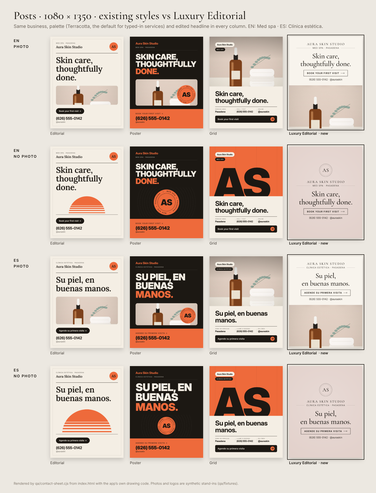

# Luxury Editorial — design notes

A fourth style in the Graphics tab (**Luxury** / **Lujo**) for higher-image service businesses:
realtors, med spas, estheticians, photographers, interior designers and boutique fitness studios.
It makes the same Post (1080 × 1350) and Story (1080 × 1920) from the same inputs as the other
styles, in English and Mexican Spanish.

## Design choices

1. **One display serif.** Cormorant Garamond Medium (SIL OFL 1.1) is calm, high-contrast and
   narrow enough for long Spanish headlines. It is paired only with Inter, which is already embedded,
   for small text. Lora (Editorial's serif) is a warm text face. Playfair and Bodoni were tried and
   run too wide and loud. The font is one 31 KB WOFF2, embedded like the others, so nothing is fetched.
2. **A centred axis.** All three existing styles are left-aligned. Luxury is centred: the business name
   as a tracked serif wordmark, then a hairline folio (service · area), then the headline, an outlined
   call to action and one contact line.
3. **Two compositions, one family.**
   - **Photo:** an ivory page with the type at the top and the photo full-bleed to the bottom edge.
     The photo gets roughly 55–65% of the canvas. In Stories it runs under the reply bar, which then
     only ever covers picture, never text.
   - **No photo / logo:** the whole canvas is a dusty tint, with a monogram seal (initials in a double
     hairline ring) or the owner's logo above the same stack, optically centred. It reads as
     stationery rather than an empty photo slot.
4. **Restrained colour from the existing palettes.** No new swatches and no new state. Ink stays as is,
   the paper is lightened 35%, and the accent keeps its hue but is capped at 30% saturation and 84%
   lightness:
   - Terracotta → clay blush
   - Pine & lime → sage
   - Midnight & sky → powder blue
   - Charcoal & sun → champagne
   - Plum & coral → mauve

   Every palette passes WCAG AA for the smallest text (checked by the self-test).
5. **A quiet call to action.** Tracked capitals in a 2 px outlined box with a drawn hairline arrow.
   There is no filled pill, badge, starburst or urgency.
6. **Typesetting for centred display type.** A small line breaker scores every way to split the
   headline:
   - even line lengths;
   - breaks after punctuation;
   - no line ending on *the / your / la / su…*;
   - no short word alone on the last line.

   It may give up to 25% of size for a clearly better break ("Su piel, / en buenas manos."). Line
   breaks the owner types are kept. Contacts and service · area split between items, never next to a
   "·", and a long area breaks at a comma rather than inside a place name ("LA / VERNE").
7. **Readable at real phone width.** A 360 px wide phone shows the 1080 px export at a third of its
   size, so the small text is sized for that view (see *Mobile readability pass* below). Side margins
   are 108 px (other styles use 84) for more air.
8. **Logos.**
   - Empty margins around an uploaded logo are trimmed automatically.
   - Transparent dark logos sit straight on the tint.
   - Solid logos keep their own background colour as a card.
   - Light logos on transparency get an ink card.
9. **Honest by construction.** Everything drawn comes from the owner's inputs: name, service, area,
   headline, CTA, contacts and initials. There is no fixed slogan, badge, price, rating, award or
   "luxury" claim. A self-test checks every drawn string against the inputs.

**Left out on purpose:**
- The long description. It belongs in the caption and bio; a cover is not a flyer.
- Arches (Editorial's), stamps (Poster's), giant initials (Grid's) and rounded app-style corners.

## Mobile readability pass

The exports were reviewed as a 360 px wide Android phone shows them, not at 1080 px. On screen, the
service · area line, the call to action and the contacts were too small. The layout, typefaces and
hierarchy are unchanged; only size, letter-spacing, contrast and the button's proportions moved.

| On a 360 px phone (screen px) | Post before → after | Story before → after | Target |
|---|---|---|---|
| Service · area | 7.7 → **10.0** | 8.7 → **11.3** | ≥ 10 |
| Call to action | 8.3 → **11.0** | 9.3 → **12.3** | ≥ 11 |
| Phone · Instagram | 10.3 → **12.3** | 11.7 → **13.7** | ≥ 12 |
| Business name | 16 | 18 → 17 (now one line, like the post) | |
| Headline | 35 | 41 | |

- **Service · area:** tracking 0.20 → 0.14 em, 68% → 80% ink.
- **Call to action:** tracking 0.16 → 0.12 em. The size is solved from the text so the button never
  overflows, with tighter padding and an outline that scales with the text. A very long CTA (33+
  characters; every built-in one is 27 or fewer) wraps to two even lines in the same button instead of
  shrinking into fine print or being cut.
- **Contacts:** 82% → 90% ink.
- **Business name:** stays on one line when that costs no more than 15% of its size.
- **Long details:** for very long names, areas or contact lists, text still never drops below 8 px on
  screen and is never cut off.

`qa/phone-view.cjs` exports a realistic post and story through the real app and shows them at 360 px
with these measurements (`phone-view-360.png`, `sample-post.png`, `sample-story.png`).

## Spanish copy fix

For typed-in services the first Spanish headline was "{S} local, hecho con cuidado.", which breaks for
feminine services ("Clínica estética … hecho") and plural ones ("Bienes raíces local"). Guessing gender
and number from what an owner types is unreliable, so the line now needs no agreement:
**"{S} cerca de usted, con atención y cuidado."** It keeps *usted* and makes no claims. A diff of all
2,544 generated strings against `main` shows that only this headline changed. A self-test locks it in
for feminine, masculine and plural services.

## Compatibility and cost

- **Saved choices.** Luxury is style index 3, so existing saved choices (0–2) keep their meaning.
  Unknown values still fall back to Editorial. Headline and CTA editing, *Another idea*, palettes,
  upload, camera, logo/photo, save, share and open are unchanged.
- **Existing styles untouched.** Editorial, Poster, Grid, before/after and the setup-screen examples
  render pixel-identical to `main` (109 renders compared by `qa/run-checks.cjs --baseline`).
- **Page size.** `index.html` goes from 319 KB to 376 KB (+57 KB; +33 KB gzipped). 31 KB of that is
  the font; the rest is the template and its self-tests.
- **Redraw time per edit** (post, story and all four thumbnails), at 4× CPU slowdown:
  - Editorial 34 ms
  - Poster 29 ms
  - Grid 46 ms
  - Luxury 41 ms

## Tests

- **`#selftest`** now runs 31 checks (was 20). Ten are new for Luxury:
  - safe areas and side margins, never text on the photo, nothing cut off (50 renders: EN/ES × post/story ×
    none/photo/portrait/logo/solid logo × normal/long/form-maximum details);
  - readable at 360 px phone width (the targets above);
  - only owner-provided text is drawn;
  - headline and CTA edits appear;
  - natural line breaks for every built-in headline;
  - palette contrast;
  - logo trimming;
  - picker registration and fallback;
  - PNG exports at 1080 × 1350 and 1080 × 1920.

  One more locks in the Spanish copy fix. The fonts and "all styles" checks now cover the new font and
  the fourth style.
- **`qa/run-checks.cjs`** runs 70 checks in headless Chromium. It drives the real owner flow at
  320/360/412 px in EN and ES (pick Luxury, edit, save both PNGs, reload) and uploads a photo and
  two logos through the actual file input. It also checks timing and, with `--baseline`, pixel
  regression. Latest results are in `results.json`.

## Known limits and follow-ups

- **Manual Android check still needed** before launch: share sheet, camera capture, real photos and
  a real phone screen.
- **Very long single words.** A name made of one very long word (no spaces) shrinks and can end in
  "…", the same as in every other style.
- **Font fallback.** If Cormorant ever failed to load, the template falls back to Georgia. Text still
  fits because everything is measured.
